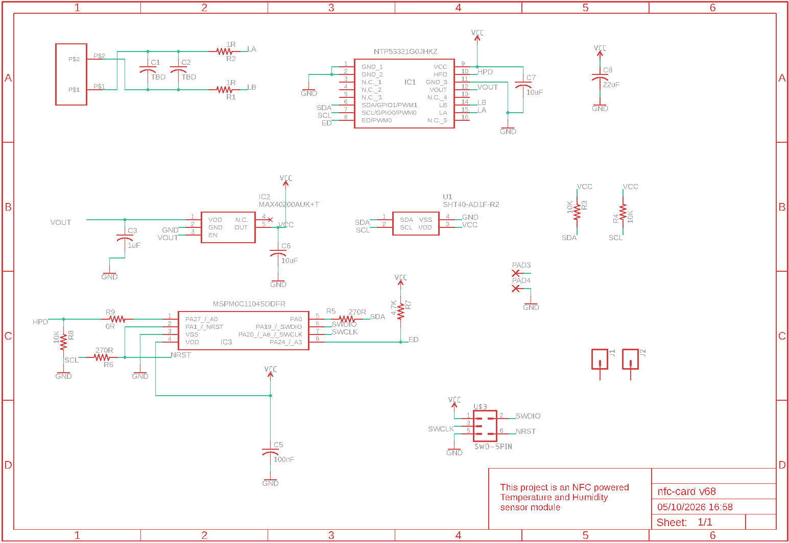
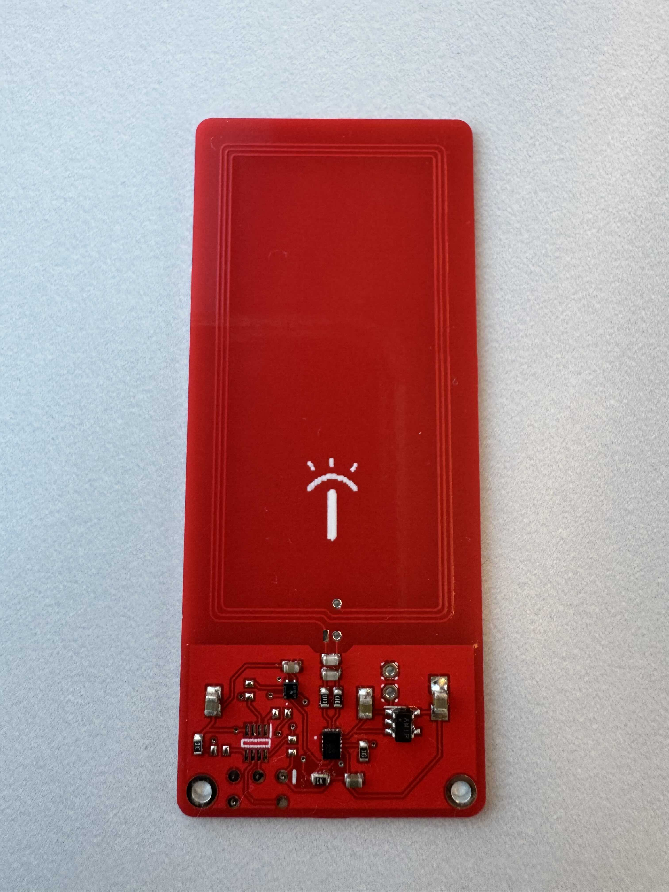
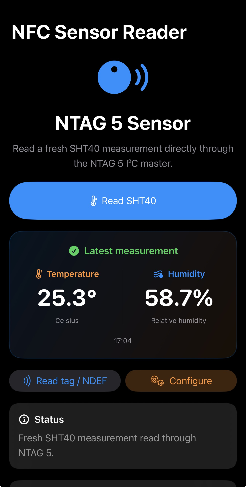

# NFC Card — Temperature and Humidity Sensor

This project is built around **OSHWA-certified open source hardware**, certified under [NL000047](https://certification.oshwa.org/nl000047.html).

A phone-powered NFC sensor board for reading temperature and relative humidity. The board uses an NXP NTAG device and a Sensirion SHT40 sensor to take a measurement and return it to a mobile phone over NFC.

The intended sensing flow uses energy harvested from the phone's NFC field, allowing a reading without a battery or an external power supply.

## How it works

1. Bring an NFC-enabled mobile phone close to the board's antenna and start a read from the mobile app.
2. The phone's NFC field supplies energy to the board.
3. The phone triggers the NTAG to request a temperature and humidity measurement from the SHT40 over I²C.
4. The measurement is returned to the phone through the NFC interface.
5. The app displays temperature and relative humidity readings.

Keep the phone close to the antenna until the reading completes so the board continues to receive power and communicate.

## Hardware

- **NFC interface:** NXP NTP53321G0JHKZ NTAG device.
- **Sensor:** Sensirion SHT40 for digital temperature and relative humidity measurements.
- **Sensor connection:** I²C (SDA and SCL).
- **Power for phone-triggered readings:** Energy harvested from the mobile phone's NFC field.

## Repository contents

| Folder | Contents |
| --- | --- |
| `Design_Files/` | EAGLE schematic (`nfc-card.sch`) and PCB layout (`nfc-card.brd`). |
| `3D/` | Reserved for mechanical models and enclosure files. |
| `App/` | Reserved for mobile app source and related files. |
| `images/` | Schematic, board renders, board photo, app screenshot, and OSHW image. |

Open the schematic and board files together in an EAGLE-compatible PCB design tool to inspect or modify the hardware. The `App/` and `3D/` folders currently contain placeholders.

## Reading the sensor

Use an NFC-enabled phone with a compatible app that supports this board's measurement flow. Enable NFC where required, start a sensor read, and hold the phone's NFC antenna near the board's antenna. The app should present temperature and relative humidity after the measurement is received.

The app screenshot below illustrates the sensor-reading interface; app source and setup instructions are not yet included in this repository.

## Images

### Schematic

### Board renders

### Assembled board

### Mobile app sensor reading

### Open Source Hardware

